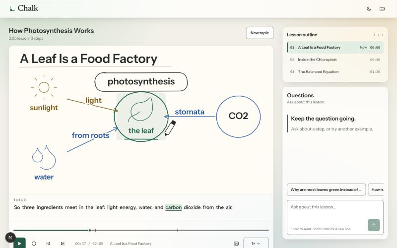
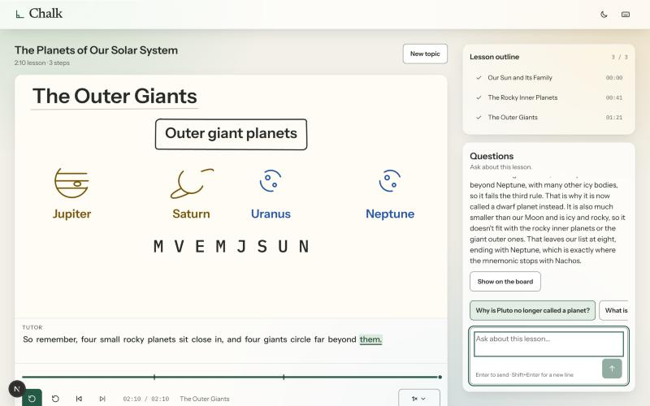
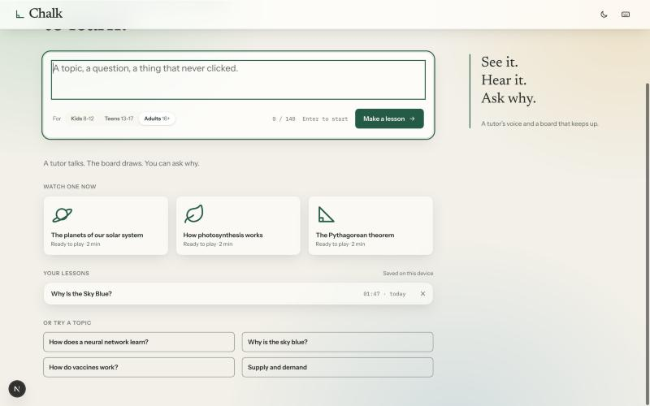
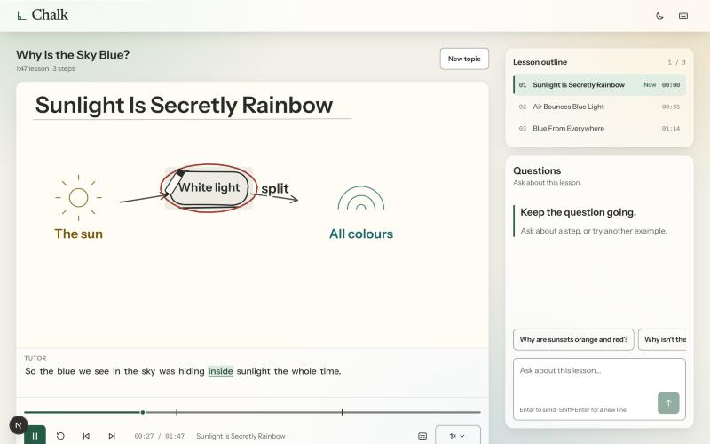

# Chalk: an AI whiteboard tutor

Type a topic and get a lesson of about two minutes. A tutor's voice explains it while a whiteboard draws pictures of the subject (planets, leaves, cells, triangles, orbits), arrows, labels and equations in step with the words. You can pause, scrub, change speed, replay, ask follow-up questions, finish with a short recall quiz, and come back to any lesson later without waiting again.

**Live demo:** https://ai-whiteboard-tutor-wine.vercel.app

**Fastest way to judge it:** open the live demo and pick one of the three ready-made lessons under *Watch one now* (planets, photosynthesis, Pythagoras). They play instantly with no AI wait. Then type your own topic, choose Kids, Teens or Adults, and ask a follow-up question at any point.

| Photosynthesis: the marker draws the sun, leaf, water and CO₂ as they are named | Planets: a follow-up answer jumps to the giants and points at them |
|---|---|
|  |  |
| **Home:** demos, saved lessons, audience selector | **Kids mode:** "Why is the sky blue?" for ages 8–12 |
|  |  |

Built for the Braynix Studios technical assignment "AI-Powered Interactive Whiteboard Tutor".

## What it does

1. **Ask.** Type a topic or question on the home screen and choose who it is for (Kids 8–12, Teens, Adults), or open a ready-made demo.
2. **Generate.** Claude writes a structured lesson: a teaching arc split into 3 scenes. Each spoken sentence carries the board actions that happen while it is said. While ElevenLabs records the narration (with per-character timestamps), the screen already shows the lesson's steps.
3. **Watch.** One marker draws the board, one stroke at a time, starting each element on its cue word. Pictures come from 169 hand-drawable icons (Lucide plus hand-drawn planets, cells, molecules and more) or are sketched by Claude from points: orbits, right triangles, waves, graphs. The caption highlights the spoken word.
4. **Control.** Play, pause, resume, seek on a timeline with step markers, go back or forward one sentence, restart, replay, 0.75×–1.5× speed, and captions on or off. Keyboard: Space, ← / →, R.
5. **Ask.** Follow-up questions are answered in the context of the lesson. When an answer refers to something on the board, the player jumps to that scene and emphasises those elements.
6. **Recall.** At the end, 2–3 questions ask the learner to retrieve what they were taught, each with feedback and a link back to the scene that taught it.

7. **Come back.** Every finished lesson is saved in your browser (IndexedDB) with its audio, under *Your lessons*. Opening one replays it with no AI calls.

If the voice fails, the lesson still plays with captions only on a virtual clock. The layout works on phones, tablets and desktops, in light and dark themes, with reduced motion, reduced transparency and high contrast.

## How the sync works

The core design choice: **the board is a pure function of media time.**

```
topic
  → Claude (structured output)       semantic lesson: scenes → beats (one sentence each) → actions on a 10×5 grid
  → validateLesson                    repairs ids, cues, overlaps, colour clashes; rejects lessons that are too short or long
  → layoutLesson                      deterministic geometry: grid cells → board coordinates, text fitting, connector routing
  → buildNarration                    the narration text plus the character span of each beat
  → ElevenLabs /with-timestamps       audio plus a start time for every character
  → buildCharClock                    maps the alignment back onto our text (exact, mapped, or estimated)
  → compileTimeline                   each action gets an absolute start time: its beat start, or its cue word's start
  → boardStateAt(t)                   what is drawn, how far, what is current, which caption word is spoken
```

- **One clock.** A single `<audio>` element is the master clock, read every animation frame. Nothing is scheduled with timers, so seeking, pausing, speed changes and replay can't drift. Seeking anywhere shows the correct board immediately.
- **Sentence anchoring.** Every board action belongs to a sentence (beat) and can name a cue word inside it. The validator checks that the cue really occurs in the sentence (whole-word match). Connectors and highlights wait at least 0.25 s after the elements they depend on.
- **The model never sends pixels.** Claude places elements on a 10×5 grid. Layout, text fitting, overlap avoidance and the hand-drawn look (seeded jitter, so the same lesson always draws the same way) happen in code.
- **One marker.** Strokes never overlap: each starts at its cue word or when the previous stroke ends, whichever is later, and never before its cue. Near the end of a step the marker draws faster instead of starting early. A unit test checks both rules on every event.
- **Pictures without pixels.** The model names an icon or writes sketch points (`"~ 50,10 80,18 … z"`), never SVG. The validator maps near-miss names (`"Saturn"` → ringed planet), turns unknown ones into a labelled circle, clamps points, and keeps pictures at least 2×2 cells so they stay recognisable. One combined `picture` action keeps the structured-output schema small enough for the API's grammar limit.
- **Stale work is dropped.** Lesson generations carry ids, so a cancelled or superseded request can't overwrite a newer one. Playback operations carry tokens, so a late `play()` promise can't resume a paused lesson.

## Learning design

The UI follows a short evidence review in [`research/`](research/learning-ux-report.md). Shipped from it:

- **Marker nib instead of a talking-head avatar.** Studies find that a face on screen adds load without improving learning, while pointing at the diagram does help.
- **End-of-lesson retrieval practice** with immediate explanatory feedback.
- **Colour-blind-safe inks:** green never appears with teal, nor brick with ochre, in the same scene. Labels always carry the meaning, never colour alone.
- Narration and the drawing appear together (temporal contiguity), the current element is signalled, a lesson is short and split into steps, and the caption highlights the spoken word.

- **Audience selector** (Kids 8–12, Teens 13–17, Adults) changes vocabulary, examples and pace; **0.75× speed** and a **captions toggle** for different reading and listening speeds.
- **Pictures of the subject in every step** (dual coding): the prompt requires at least one drawing of the actual thing per scene.

Still deferred from the research: check questions at the end of each step (end-of-lesson recall covers retrieval for now).

## Built with two agents

The plan and parts of the code came from a Claude Code + OpenAI Codex pairing: each drafted a plan independently, critiqued the other's, and the merged plan (with a table of disagreements decided by the owner) is in `.duo/`. Codex built the IndexedDB history store, the request/token hardening and their tests in separate git worktrees; Claude reviewed and merged them.

## Tech stack

- **Next.js 16** (App Router), **React 19**, **TypeScript** (strict), **Tailwind CSS 4**
- **Claude** (`claude-opus-5-5`) through `@anthropic-ai/sdk`, with structured output validated by **Zod**
- **ElevenLabs** text-to-speech with timestamps (`eleven_multilingual_v2`)
- **Vitest** for unit tests; deployed on **Vercel**

```
src/
  app/                  page + API routes: /api/lesson, /api/narration, /api/ask, /api/demo
  components/           HomeView, GeneratingView, AppHeader, ui/
    board/Whiteboard    SVG renderer for one board state (no timers)
    player/             PlayerView, Transport, Questions, Recall
  hooks/                usePlayback (audio or virtual clock), useLessonSession (generation, demos, saved lessons),
                        useLessonQuestions (one follow-up conversation per lesson)
  lib/
    lesson/             schema, validation and repair, narration text
    board/              grid layout, hand-drawn sketch paths, icons (generated by scripts/build-icons.mjs)
    demos/              three recorded demo lessons (audio in public/demos)
    storage/            IndexedDB lesson history
    timeline/           alignment → clock, timeline compiler, boardStateAt
    server/             Claude and ElevenLabs clients, signed lesson tokens, rate limiting, env
design/                 product brief and design spec
research/               learning-science report and per-age notes
```

## Run it locally

Requirements: Node.js 20 or newer, an Anthropic API key, and an ElevenLabs API key with a voice ID.

```bash
git clone https://github.com/danish-ship-it/ai-whiteboard-tutor.git
cd ai-whiteboard-tutor
npm install
cp .env.example .env.local   # then fill in the values
npm run dev                  # http://localhost:3000
```

| Variable | Required | Purpose |
|---|---|---|
| `ANTHROPIC_API_KEY` | yes | Lesson generation and follow-up answers |
| `ELEVENLABS_API_KEY` | yes* | Narration |
| `ELEVENLABS_VOICE_ID` | yes* | The voice to use (from ElevenLabs → Voices) |
| `LESSON_SIGNING_SECRET` | yes | Signs lessons so the voice and Q&A endpoints only accept server-generated lessons (`openssl rand -hex 32`) |
| `ANTHROPIC_MODEL` | no | Overrides the model (default `claude-opus-5-5`) |
| `ELEVENLABS_MODEL_ID` | no | Overrides the TTS model (default `eleven_multilingual_v2`) |
| `LESSON_EFFORT` | no | Claude effort for lessons: `low` (default, fastest), `medium`, `high` |

\*Without ElevenLabs the app still works, with captions only.

All keys are read on the server only. None are exposed to the browser or committed to the repository.

```bash
npm test            # unit tests: validation, layout, timeline/sync, history store, tokens, request limits
npm run typecheck
npm run lint
npm run build
```

**Deploying to Vercel:** import the repository, add the variables above under Project → Settings → Environment Variables, and deploy. The API routes set their own `maxDuration`.

## Measured performance

These numbers come from local and production runs in November 2026.

| Step | Time |
|---|---|
| Lesson generation (Claude, effort `low`) | 20–25 s |
| Narration (ElevenLabs, one call per lesson) | 10–13 s |
| Follow-up answer | ~5 s |
| Lesson length | ~1:50–2:25 |
| Narration response size | ~2 MB (under Vercel's 4.5 MB limit) |

## Security and limits

- API keys live only in server environment variables.
- Request bodies are read as a stream and cut off at a byte limit, whatever `Content-Length` says. Tokens are checked for exact structure, a finite issue time and a constant-time signature match.
- Security headers on every route: `nosniff`, strict referrer policy, no framing (`X-Frame-Options` and CSP `frame-ancestors`), camera/microphone/location disabled.
- The learner's topic is passed to Claude inside a `<topic>` tag and the prompt treats it as subject matter only, never as instructions.
- Lessons are signed with HMAC-SHA256 and expire after 12 hours, so `/api/narration` and `/api/ask` can't be used to synthesise or prompt with arbitrary text.
- Per-IP sliding-window rate limits (per 10 minutes): 6 lessons, 10 narrations, 30 questions. Input sizes are capped.

## Known limitations

- The rate limiter is in memory per server instance, so it is a basic guard rather than a global quota. Production use would move it to a shared store (e.g. Redis).
- Board labels are capped at three short words to stay legible on phones. Very dense topics are simplified rather than crammed in.
- Follow-up answers point at existing board elements. They don't draw new diagrams.
- Generation takes 30–40 s end to end. The progress screen shows each stage and the lesson outline; demo and saved lessons skip the wait entirely. Streaming the first scene before the rest is ready would cut it further.
- Saved lessons live in one browser and can be evicted by it. Follow-up questions on a saved lesson work for 12 hours (the token lifetime); after that it still replays.
- AI-generated images or video per step are not included: ElevenLabs' image/video API needs a Pro plan, and video takes minutes per clip.
