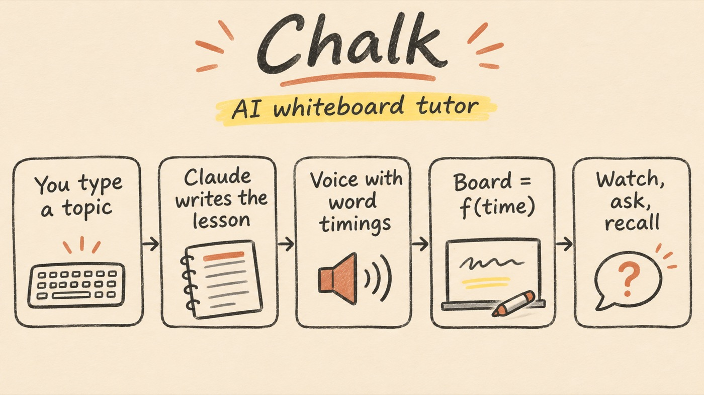
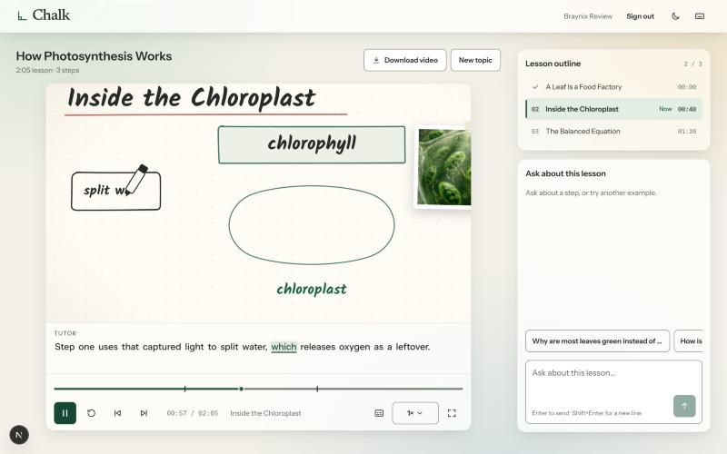
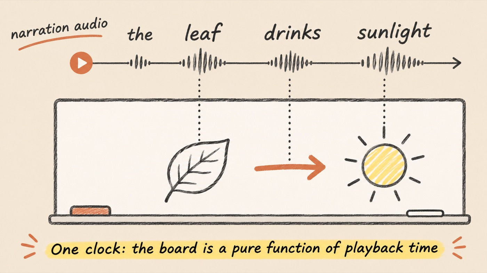
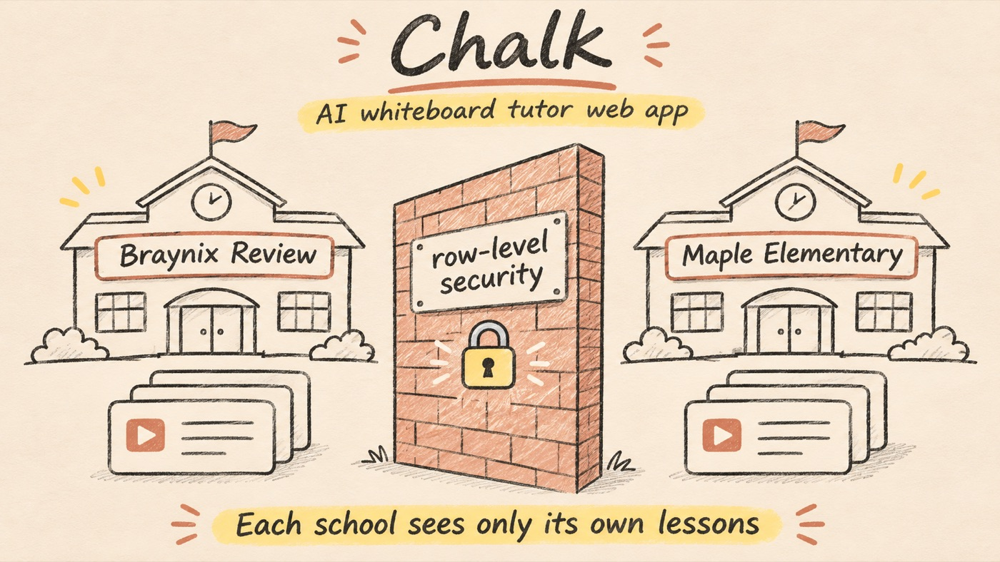
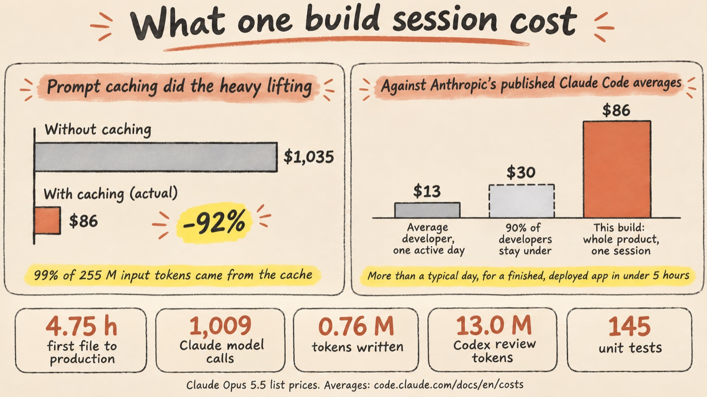

# Chalk: an AI whiteboard tutor

Type a topic and get a lesson of about two minutes. A tutor's voice explains it while a hand-drawn whiteboard sketches the subject (planets, leaves, cells, triangles, orbits), arrows, labels and equations in step with the words. Pause, scrub, ask a follow-up question at any moment, finish with a short recall quiz, come back to any lesson later, or download it as a video.

**Live demo:** https://ai-whiteboard-tutor-wine.vercel.app · **Reviewer guide:** [REVIEW.md](REVIEW.md) maps each evaluation dimension to the code and tests behind it



## Review it in two minutes

1. Open the live demo. On the sign-in page, click **Braynix Review**. It signs you into a demo school with one click; no password is needed or shown.
2. Under *Watch one now*, open **How photosynthesis works**. Ready-made lessons play instantly with no AI wait.
3. While it plays, type a question in *Ask about this lesson*. The answer points at the drawings it talks about.
4. Click **Download video** to get the lesson, board and voice, as an MP4 made in your browser.
5. Type your own topic, pick Kids, Teens or Adults, and watch a new lesson being made live (about 30–40 s).
6. Sign out and sign in as **Maple Elementary**: it is a separate school and can't see Braynix Review's lessons.

| The sketchbook board: hand lettering, pencil lines that boil, the step's photo pinned on | A follow-up answer jumps to the giants and points at them |
|---|---|
|  |  |
| **Home:** demos, saved lessons, audience selector | **Kids mode:** "Why is the sky blue?" for ages 8–12 |
|  |  |

Built for the Braynix Studios technical assignment "AI-Powered Interactive Whiteboard Tutor".

## The idea

**Who it is for:** a curious learner, from a 9-year-old to an adult, who has a question right now ("how does photosynthesis work?") and a teacher who wants a short visual explanation for a class.

**The problem:** text answers from a chatbot are walls of words, and video explainers exist only for popular topics. The best explanation is a teacher at a whiteboard: talking and drawing at the same time, pointing at what they mean, and stopping for questions.

**What Chalk does about it:** it makes that whiteboard lesson for any topic on demand. Claude plans the lesson as spoken sentences plus board actions, a voice reads it, and the board draws each thing at the moment it is named. The learner can interrupt with a question at any time, and the lesson ends with retrieval practice, because recalling beats re-reading.

## What it does

1. **Ask.** Type a topic or question and choose who it is for (Kids 8–12, Teens, Adults), or open a ready-made demo.
2. **Generate.** Claude writes a structured lesson: a teaching arc split into 3 scenes, each spoken sentence carrying the board actions that happen while it is said. While ElevenLabs records the narration (with per-character timestamps), the screen already shows the lesson's steps.
3. **Watch.** One marker draws the board, one stroke at a time, starting each element on its cue word. Pictures come from 169 hand-drawable icons or are sketched by Claude from points (orbits, triangles, waves). The caption highlights the spoken word.
4. **Exact graphs.** When a lesson involves a function, coordinates, a slope or where two lines cross, Claude writes the equation and the board plots it exactly on Cartesian axes with numbered ticks: the curve draws itself with a live (x, y) readout at the pen tip, marked points drop dashed guides to both axes, and every label finds a clear spot. The narration uses the same numbers and equations, so "at x equals three, y is five" is said while (3, 5) appears. The expression parser is written for this (no `eval`).
5. **A living sketchbook.** The board is drawn like an animated pencil sketch, after the sketchbook style of [cth9191/animate](https://github.com/cth9191/animate): lines *boil* (every stroke cycles through three hand-drawn takes, so it trembles like hand animation while its shape never moves), each outline is pencilled and then inked with a second pass that doesn't quite agree, labels are hand lettered, the page has a dot grid, a vignette and a coffee ring, the title gets a red marker underline, and each new step slides onto the page with a small spring. A slow camera leans in on what is being drawn, finished drawings keep moving (the sun turns, leaves sway, dots flow along arrows), and everything pauses with the lesson and is off under reduced motion.
6. **Control.** Play, pause, seek on a timeline with step markers, step one sentence back or forward, restart, 0.75×–1.5× speed, captions, full screen. Keyboard: Space, ← / →, R.
7. **Ask.** Follow-up questions are answered in the context of the lesson. When an answer refers to something on the board, the player jumps to that scene and highlights those drawings.
8. **See it for real.** A realistic AI picture of each step is pinned to a corner of the board like a photo, then comes to life as a 5-second clip that plays and pauses with the lesson.
9. **Download the lesson as a video.** One click records the board and the voice into an MP4 (WebM where MP4 isn't supported), 1280×720, with the step pictures. It is rendered entirely in the browser from the same timeline the player uses, so nothing is uploaded.
10. **Recall.** At the end, 2–3 questions ask the learner to retrieve what was taught, with feedback and a link back to the scene that taught it.
11. **Schools.** Each school (tenant) signs in and sees only its own lessons. Every finished lesson is saved with its audio, pictures and clips, and replays later with no AI calls.

If the voice fails, the lesson still plays with captions on a virtual clock. The layout works on phones, tablets and desktops, in light and dark themes, with reduced motion, reduced transparency and high contrast.

## What is live and what is prerecorded

| Capability | Status |
|---|---|
| Lesson writing (Claude `claude-opus-5-5`) | **Live** for every typed topic |
| Narration with word timings (ElevenLabs) | **Live** for every typed topic |
| Follow-up answers (Claude) | **Live**, including on the demo lessons |
| Step pictures and clips (BBANANA) | **Live** for new lessons when the server has a key; each school has a daily budget |
| Whiteboard drawing, animation, camera | **Computed** in the browser from the lesson and the audio timings; no video model involved |
| Download video | **Computed** in the browser from the same timeline |
| The three *Watch one now* lessons | **Prerecorded**: lesson, narration, pictures and clips are stored in the repository so reviewers can watch without waiting or spending |
| Demo schools | Real accounts in a real database, with a password kept on the server; the buttons sign in through a server route |

## How the sync works



The core design choice: **the board is a pure function of media time.**

```
topic
  → Claude (structured output)       semantic lesson: scenes → beats (one sentence each) → actions on a 10×5 grid
  → validateLesson                    repairs ids, cues, overlaps, colour clashes; rejects lessons that are too short or long
  → layoutLesson                      deterministic geometry: grid cells → board coordinates, text fitting, connector routing
  → buildNarration                    the narration text plus the character span of each beat
  → ElevenLabs /with-timestamps       audio plus a start time for every character
  → buildCharClock                    maps the alignment back onto our text (exact, mapped, or estimated)
  → compileTimeline                   each action gets an absolute start time: its beat start, or its cue word's start
  → boardStateAt(t)                   what is drawn, how far, what is current, which caption word is spoken
```

- **One clock.** A single `<audio>` element is the master clock, read every animation frame. Nothing is scheduled with timers, so seeking, pausing, speed changes and replay can't drift. Seeking anywhere shows the correct board immediately.
- **The same function makes the video.** The exporter calls `boardStateAt(t)` for each frame, renders the board to SVG, rasterises it to a canvas and records it with the narration. The boil, camera and spring are pure functions of time too, so a frame is identical however it was reached (a unit test checks this).
- **Sentence anchoring.** Every board action belongs to a sentence and can name a cue word inside it. The validator checks that the cue really occurs in the sentence. Connectors and highlights wait for the elements they depend on.
- **The model never sends pixels.** Claude places elements on a grid and names icons or writes sketch points (`"~ 50,10 80,18 … z"`), never SVG. Layout, text fitting, overlap avoidance and the hand-drawn look (seeded jitter, so a lesson always draws the same way) happen in code.
- **One marker.** Strokes never overlap: each starts at its cue word or when the previous stroke ends, whichever is later. A unit test checks this on every event.
- **Stale work is dropped.** Generations carry ids and playback operations carry tokens, so a late answer can't overwrite newer state.

## Learning design

The UI follows a short evidence review in [`research/`](research/learning-ux-report.md):

- **A marker nib instead of a talking-head avatar.** A face on screen adds load without improving learning; pointing at the diagram helps.
- **Narration and drawing together** (temporal contiguity), the current element signalled, short lessons split into steps, the spoken word highlighted in the caption.
- **Pictures of the subject in every step** (dual coding).
- **End-of-lesson retrieval practice** with explanatory feedback.
- **Audience selector** that changes vocabulary, examples and pace; 0.75× speed and captions for different reading and listening speeds.
- **Colour-blind-safe inks:** clashing pairs never share a scene, and labels always carry the meaning.

## Schools and security



- **Tenant isolation lives in the database.** Postgres row-level security decides who sees which lessons and narration files, through a `security definer` helper. `scripts/check-tenants.mjs` signs in as both demo schools and checks 12 cases (read, edit, delete, insert and audio across schools, and signed-out access).
- **Paid routes need a school member.** Every route that spends money (lesson, voice, questions, pictures) requires a signed-in member of a school; an account with no school gets 403, and production refuses to run them without sign-in configured.
- **Daily budget per school** (40 lessons, 40 narrations, 200 questions, 120 pictures, 30 clips), counted by one atomic database statement, so it holds across server instances and concurrent requests.
- **Signed lessons.** Lessons are signed with HMAC-SHA256 and expire after 12 hours, so the voice and question endpoints can't be used to synthesise or prompt arbitrary text. The picture endpoint only illustrates scenes of a lesson this server signed.
- **No secrets in the repository or the browser.** Keys live in server environment variables; only the Supabase URL and publishable key reach the browser, by design. The repository and its full git history were scanned for keys before submission.
- Request bodies are capped while streaming, inputs are size-limited, rate limits apply per user, the learner's topic is passed to Claude as subject matter only, and security headers are set on every route.

## Built in an afternoon, by two AI agents and one engineer

From an empty folder to the deployed app took **about 4.75 hours** of wall-clock time on 16–17 November 2026, using Claude Code (Claude Opus 5.5) as the main engineer and OpenAI Codex (GPT-6) as a second agent for planning critique, blind code reviews and the README illustrations.

| | |
|---|---|
| Wall-clock time, first file to production | **≈ 4.75 hours** |
| Claude Code: model calls | 1,009 |
| Claude Code: tokens written (output) | 0.76 M |
| Claude Code: tokens read | 254.9 M, of which **99 % came from the prompt cache** (2.6 M fresh) |
| Claude Code: cost at Opus 5.5 list prices | **≈ $86**; without the prompt cache the same work would cost ≈ $1,035 |
| Codex: tokens across 19 review and planning sessions | 13.0 M |
| Result | 145 unit tests, 4 end-to-end tests |



How the work was split:

- **Plan, then critique.** Claude and Codex each drafted a plan without seeing the other's, then critiqued each other's; the merged plan and a table of disagreements decided by the engineer are in [`.duo/`](.duo/).
- **Build in parallel.** Codex built the IndexedDB history store and the request hardening in separate git worktrees; Claude reviewed and merged them.
- **Review blind.** Before each release Codex reviewed the diff without Claude's conclusions. The last review found five real issues in the video exporter (Safari audio activation, cleanup on a failed start, cancelling during preparation, a double start, missing pictures); all were fixed before shipping.
- **Verify in a real browser.** Every visible change was checked in a browser, including recording a full lesson to video and inspecting the file's length, resolution, audio and frames.

For scale, Anthropic reports that Claude Code averages about $13 per developer per active day across enterprise deployments, with 90 % of users under $30 ([source](https://code.claude.com/docs/en/costs)). This session spent more than a typical day, and produced a complete, deployed product with it.

Token counts come from the Claude Code and Codex session logs on the development machine; costs are those counts at Claude Opus 5.5 list prices ($4 / $20 per million input / output tokens, $0.20 cache reads, $8 one-hour cache writes). Cached reads are what makes long agent sessions affordable: the conversation is re-read from cache on every step instead of being processed again.

## Tech stack

- **Next.js 16** (App Router), **React 19**, **TypeScript** (strict), **Tailwind CSS 4**
- **Claude** (`claude-opus-5-5`) through `@anthropic-ai/sdk`, structured output validated by **Zod**
- **ElevenLabs** text-to-speech with timestamps (`eleven_multilingual_v2`)
- **BBANANA** for step pictures (Nano Banana 2.1) and 5-second clips (Grok Imagine Video 1.5 Lite); **Runway** as the alternative provider
- **Supabase**: Postgres with row-level security, auth, private storage for narration
- **MediaRecorder + Canvas** for the in-browser video export; **Kalam** for hand lettering
- **Vitest**, **Playwright**, **GitHub Actions** CI; deployed on **Vercel**

```
src/
  app/                  page + API routes: /api/lesson, /api/narration, /api/ask, /api/demo, /api/visual, /api/auth/demo
  app/login/            sign-in page (demo schools and email/password)
  proxy.ts              refreshes the session and sends signed-out visitors to /login
  components/
    board/Whiteboard    SVG renderer for one board state (no timers): boil, paper, camera, scene entrance
    player/             PlayerView, Transport, Questions, Recall, BoardPhoto, VideoExport
  hooks/                usePlayback (audio or virtual clock), useLessonSession, useLessonQuestions, useSceneVisuals
  lib/
    lesson/             schema, validation and repair, narration text
    board/              grid layout, hand-drawn sketch paths, icons, camera and spring motion
    export/             record-video: frames from boardStateAt(t) → canvas → MediaRecorder
    timeline/           alignment → clock, timeline compiler, boardStateAt
    storage/            lesson history: Supabase per school, or IndexedDB without Supabase
    server/             Claude, ElevenLabs, BBANANA and Runway clients, auth and budgets, signed tokens, rate limits
supabase/migrations/    tenants, memberships, lessons, row-level security, quotas, private narration bucket
scripts/                seed-demo.mjs (demo schools), check-tenants.mjs (isolation check)
design/  research/      product brief, design spec, learning-science report
```

## Run it locally

Requirements: Node.js 20 or newer, an Anthropic API key, and an ElevenLabs API key with a voice ID.

```bash
git clone https://github.com/danish-ship-it/ai-whiteboard-tutor.git
cd ai-whiteboard-tutor
npm install
cp .env.example .env.local   # then fill in your own values
npm run dev                  # http://localhost:3000
```

| Variable | Required | Purpose |
|---|---|---|
| `ANTHROPIC_API_KEY` | yes | Lesson generation and follow-up answers |
| `ELEVENLABS_API_KEY` | yes* | Narration |
| `ELEVENLABS_VOICE_ID` | yes* | The voice to use |
| `LESSON_SIGNING_SECRET` | yes | Signs lessons (`openssl rand -hex 32`) |
| `ANTHROPIC_MODEL` | no | Overrides the model (default `claude-opus-5-5`) |
| `ELEVENLABS_MODEL_ID` | no | Overrides the TTS model (default `eleven_multilingual_v2`) |
| `LESSON_EFFORT` | no | Claude effort for lessons: `low` (default), `medium`, `high` |
| `BBANANA_API_KEY` | no | Turns on step pictures and clips for new lessons. Takes priority over Runway |
| `RUNWAYML_API_SECRET` | no | Alternative picture and clip provider |
| `NEXT_PUBLIC_SUPABASE_URL` | no | Turns on sign-in and per-school lesson history |
| `NEXT_PUBLIC_SUPABASE_PUBLISHABLE_KEY` | no | The project's publishable key; safe in the browser because row-level security decides access |
| `DEMO_ACCOUNT_PASSWORD` | no | Password of the demo school accounts; server only |
| `SUPABASE_SECRET_KEY` | seeding only | Used by `scripts/seed-demo.mjs`; never needed by the running app |

\*Without ElevenLabs the app still works, with captions only. Without Supabase the app skips sign-in and saves lessons in the browser. `.env.example` lists every variable with placeholder values only.

To set up the database: create a Supabase project, run `supabase link` and `supabase db push`, then `node --env-file=.env.local scripts/seed-demo.mjs` and `node --env-file=.env.local scripts/check-tenants.mjs`.

```bash
npm test            # unit tests: validation, layout, timeline sync, camera and spring, video frames, storage, tokens
npm run typecheck
npm run lint
npm run build
npm run e2e         # Playwright: demo playback, mocked generation failure and cancel, shared Q&A
```

**Deploying to Vercel:** import the repository, add the variables above under Project → Settings → Environment Variables, and deploy.

## Measured performance

From local and production runs in November 2026.

| Step | Time |
|---|---|
| Lesson generation (Claude, effort `low`) | 20–25 s |
| Narration (ElevenLabs, one call per lesson) | 10–13 s |
| Follow-up answer | ~5 s |
| Lesson length | ~1:50–2:25 |
| Video export of a 2:05 lesson | 2:06 (records in real time), ~31 MB MP4 at 1280×720 |

## Known limitations and what I would do next

- **Video export runs in real time** (a two-minute lesson takes two minutes) because it uses MediaRecorder. WebCodecs with an MP4 muxer would make it several times faster. Step pictures are included; their 5-second clips are not, and a picture from a host without CORS is left out (that step is laid out without the corner).
- **Generation takes 30–40 s.** The progress screen shows each stage and the outline; streaming the first scene before the rest is ready would cut the wait.
- Follow-up answers point at existing drawings; they don't draw new diagrams yet.
- Board labels are capped at three short words to stay legible on phones; dense topics are simplified.
- Signed lesson tokens aren't bound to a school, so a copied token can be replayed by another signed-in member for 12 hours; the daily budget bounds the cost. The demo schools are public on purpose and can spend up to their daily budget.
- The 10-minute rate limiter is in memory per server instance; the database budget is the real cap.
- Sign-in is demo accounts and email/password only: no sign-up, invitations or school switching.
- Without Supabase, saved lessons live in one browser and can be evicted.
- The picture prompt is built in code from the scene rather than written by Claude, because one more field made the structured-output grammar too large for the API.
- BBANANA has no public REST reference, so the server calls its MCP endpoint (JSON-RPC over HTTP) with the API key as a Bearer token.

## Credits

Exact graphs that plot themselves with a live (x, y) readout follow the `/graph` idea in [artemnovitckii/claude-animation-skills](https://github.com/artemnovitckii/claude-animation-skills) (MIT), rebuilt for this board. The sketchbook look (line boil on a few takes, a second pencil pass, page texture, spring motion) is adapted from the ideas in [cth9191/animate](https://github.com/cth9191/animate) (MIT); the code here is written for this SVG board. README illustrations and the cost chart were generated with OpenAI Codex (GPT-6 Astra); the chart's numbers come from the session logs. Icons are based on Lucide (ISC).
